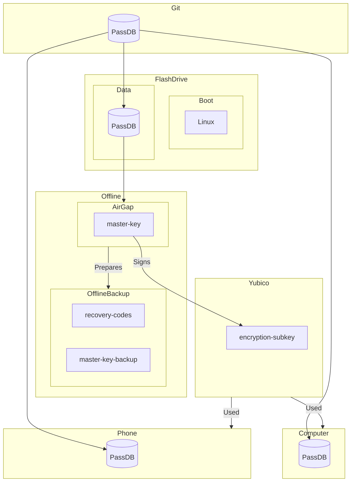

## GnuPG operations utilities

Set of utilities for operating offline set of master GPG keys as well as backups.

- GPG master keys are kept offline and operated only on air sealed computer using Linux bootable flash drive
- GPG keys are encrypted using OpenSSL encryption
- contains scripts for bacling up master keys as well as key backup information from




## Environment

- Boot into Debian Live CD (11.7.0). Preferably offline.
- Mount volume
  ```console
  $ mount -o $(id -u) /dev/sdb2 /mnt
  ```
- Unlock GPG storage
  ```console
  $ unlock.sh /mnt/gpg-master.enc
  ```
- After work done dont't forget to update locked storage
  ```console
  $ lock.sh /mnt/gpg-master.enc
  ```
